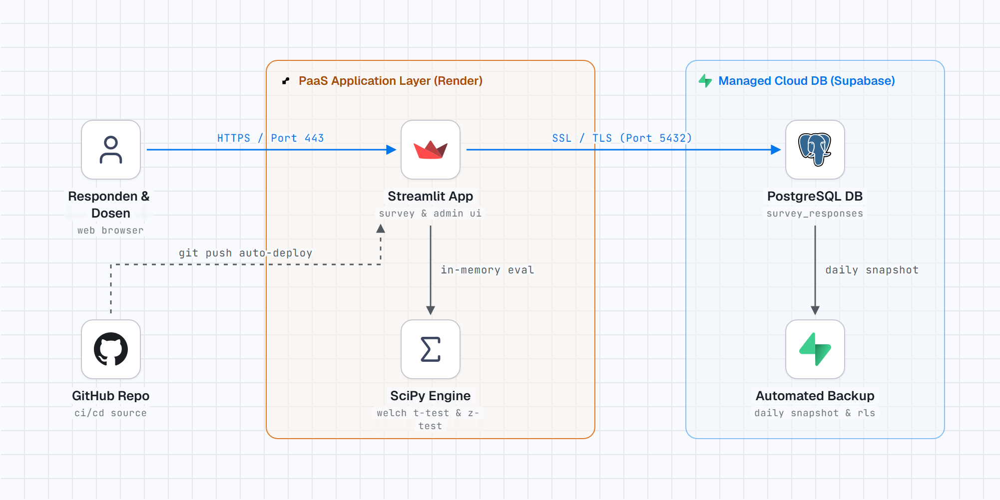

# Dokumen Arsitektur & Justifikasi Service Model

## 1. Diagram Arsitektur Sistem

Sistem ini dirancang sebagai platform survei daring berbasis komputasi awan yang terintegrasi langsung dengan mesin analisis statistik inferensial (A/B testing) secara *real-time*.

*Gambar 1: Diagram Arsitektur Cloud-Native Platform Survei & Uji A/B berbasis PaaS (Render / Streamlit Cloud) dan Managed Database PostgreSQL (Supabase). [Buka Versi Interaktif Standalone (HTML)](./architecture-diagram.html)*

---

## 2. Rincian Komponen Arsitektur Sistem

| Layer / Komponen | Teknologi & Platform | Service Model | Fungsi Utama dalam Sistem | Protokol & Jaringan |
| :--- | :--- | :--- | :--- | :--- |
| **Client Layer** | Web Browser (Responden & Dosen) | Client-side Client | Mengisi formulir survei A/B dan mengakses panel hasil analisis | HTTPS / TLS (Port 443) |
| **PaaS Web App** | Streamlit (Python Runtime) | PaaS (Render / Streamlit Cloud) | Hosting antarmuka survei, pengacakan varian A/B (50:50), dan proteksi password admin | HTTP / WebSockets (Port 8000 / 443) |
| **In-Memory Analytics** | SciPy & Statsmodels | In-Process Engine (`stats_engine.py`) | Komputasi Power Analysis, uji normalitas (Shapiro-Wilk), Welch's t-test, Z-test, dan selang kepercayaan | In-memory function call (`< 200 ms`) |
| **Managed Database** | PostgreSQL Server | Managed Database / DBaaS (Supabase) | Penyimpanan relasional tabel `survey_responses` dengan proteksi Row Level Security (RLS) | PostgreSQL SSL (Port 5432) |
| **Backup & Recovery** | Supabase Automated Backup | Managed Cloud Storage | Snapshot harian otomatis untuk menjamin integritas data survei | Internal Cloud Sync |
| **CI/CD & DevOps** | GitHub Repository | SaaS | Version control source code dan pemicu otomatisasi deployment saat ada `git push` | Git HTTPS / Webhook |

---

## 3. Pilihan Service Model: PaaS & Managed Database

Proyek ini memilih model layanan **Platform as a Service (PaaS)** yang dipadukan dengan **Managed Relational Database**:

* **PaaS untuk Web Application (Render / Streamlit Cloud):**
  Mengeliminasi kompleksitas manajemen sistem operasi, patch keamanan kernel, konfigurasi web server (seperti Nginx reverse proxy), dan routing port manual. Kode Python di-deploy langsung dari repositori Git.
* **Managed Database (Supabase PostgreSQL):**
  Menyediakan database PostgreSQL production-ready dengan koneksi terenkripsi (SSL), antarmuka web table editor, dan fitur *automated backup* tanpa perlu instalasi dan pemeliharaan server database mandiri.

---

## 4. Perbandingan dengan Alternatif Service Model

| Aspek Penilaian | PaaS + Managed DB (Pilihan Proyek) | Alternatif: IaaS murni (VM / EC2 / Compute Engine) |
| :--- | :--- | :--- |
| **Beban Operasional DevOps** | **Sangat Rendah:** Fokus 100% pada logika aplikasi & statistik | **Tinggi:** Wajib konfigurasi OS Linux, firewall, Nginx, Systemd, dan secure DB |
| **Biaya Idle (Non-aktif)** | **\$0.00 (Free Tier):** Container sleep otomatis saat sepi | **Berbayar:** VM tetap menagih jam nyala meskipun tidak ada pengunjung |
| **Kesiapan Backup & DR** | **Otomatis:** Snapshots harian bawaan platform cloud | **Manual:** Wajib menulis script cron dump PostgreSQL mandiri |
| **Kecepatan Deployment** | Hitungan menit via integrasi Git push | Berjam-jam untuk provisioning dan hardening server |
| **Justifikasi Pemilihan** | Optimal untuk siklus proyek 3 minggu dengan tim homogen Statistika | Terlalu membuang waktu pada administrasi sistem yang tidak dinilai |
